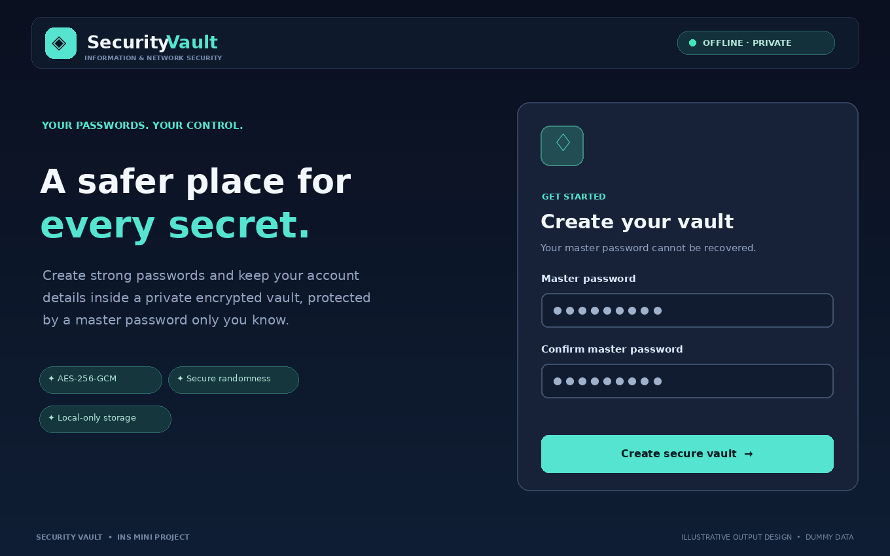
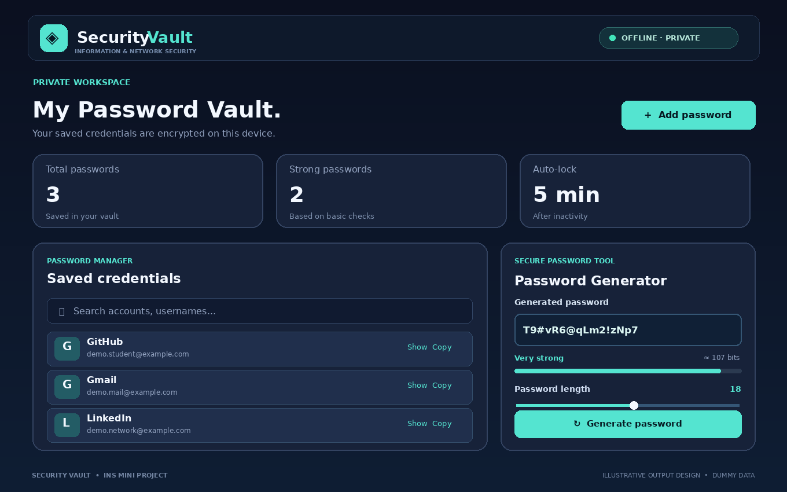
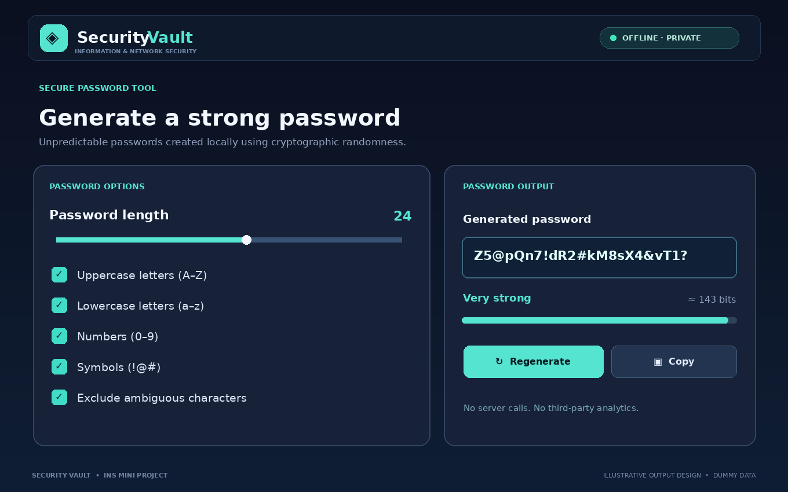
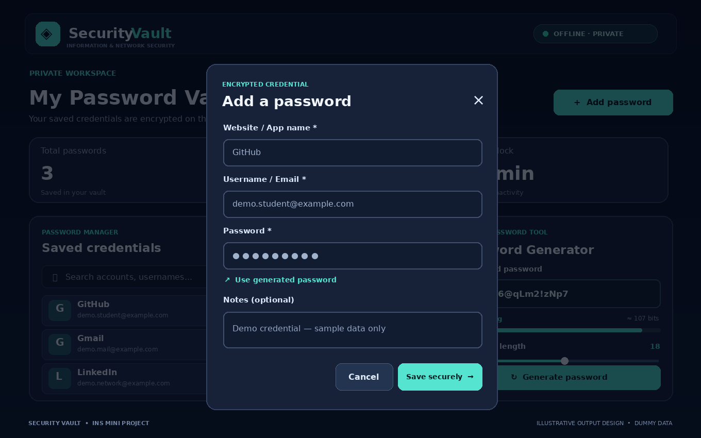

# 🔐 Security Vault

### Information and Network Security Mini Project

A secure password generator and encrypted
password management application developed
using HTML, CSS, and JavaScript.

## 📸 Project Screenshots

### 1. Secure Login Page

### 2. Security Vault Dashboard

### 3. Password Generator

### 4. Password Manager

## 🛠️ Technologies Used
- HTML5
- CSS3
- JavaScript
- Web Crypto API

<h2>📸 Project Screenshots</h2>

<table>
  <tr>
    <td align="center">
      
      
Secure Login Page

    </td>
    <td align="center">
      
      
Vault Dashboard

    </td>
  </tr>
  <tr>
    <td align="center">
      
      
Password Generator

    </td>
    <td align="center">
      
      
Password Manager

    </td>
  </tr>
</table>

- AES-256-GCM Encryption
- PBKDF2 Key Derivation

## 🔒 Security Notice
This project is developed for educational
purposes. Use dummy credentials for testing.
